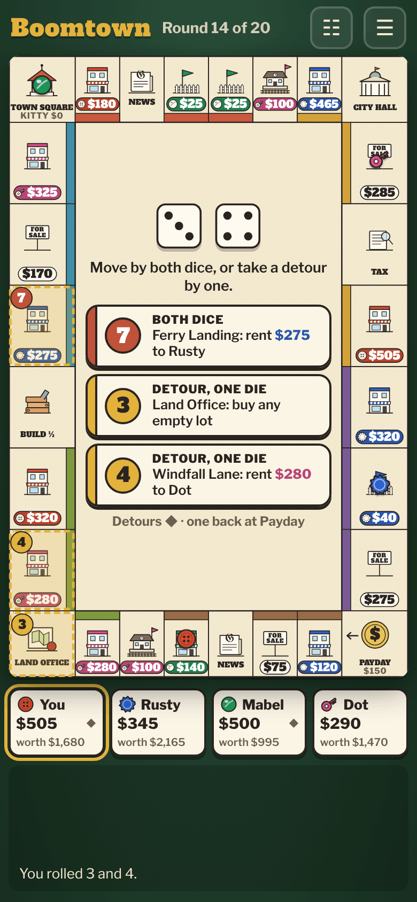
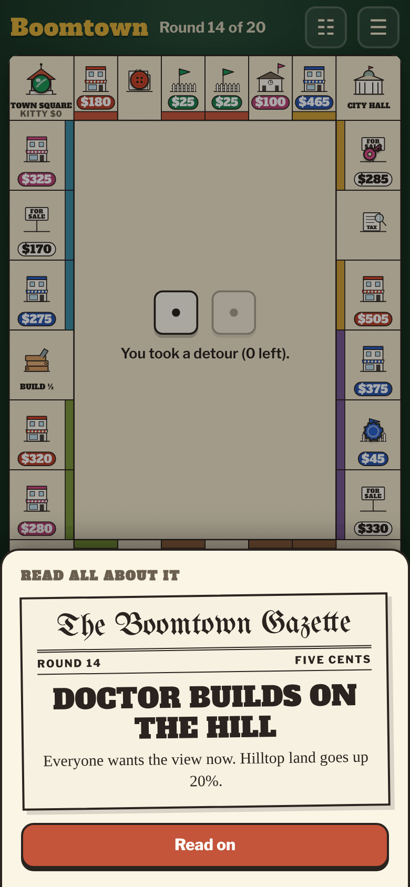
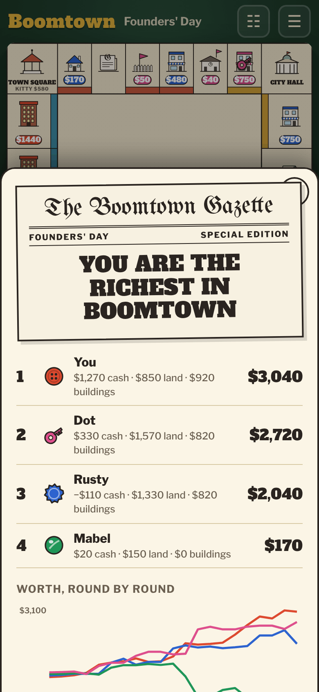

# Boomtown

**Play it: [boomtown.junkdrawer.works](https://boomtown.junkdrawer.works/)**

**An around-the-board game in a town that isn't built yet.** You buy empty lots round a ring road and build on them: For Sale signs turn into houses, then shops, then brick blocks. Every building lifts the land and the rents on its street, rivals' lots included. When the last round ends it's Founders' Day, and whoever is worth the most wins. Play the townsfolk, or pass the phone.

<p align="center">
  
  &nbsp;
  
  &nbsp;
  
</p>

## How it plays

- **Pick your move.** Roll two dice and move by both, or spend a detour to move by just one. You start with two detours and get one back each time you pass Payday, so you can dodge the worst rents, but not every time.
- **Buy, then build.** Land on a lot for sale and you can buy it. On your turn you can build on your lots: a house, then a shop, then a block. A block needs the whole district.
- **The street rises together.** Each building raises the land value of its district, and each lot with a building on it adds 30% to the rent of the other lots there, whoever owns them. Owning a whole district doubles the rent on its empty lots.
- **Make them sell.** Land on a rival's lot with nothing built on it, and if they don't own the whole district, you can make them sell it to you at one and a half times its land value instead of paying rent.
- **The corners.** Payday pays $150 as you pass and $250 if you land on it. The Land Office sells you any empty lot. Town Square pays out the kitty, where fines and taxes collect. City Hall rezones a district, putting its land up 20%.
- **The Gazette.** Headlines move land values up and down, pay out at the county fair, or burst your pipes.
- **Nobody goes out.** Can't pay? The bank lends you the rest at 10% each Payday, and money coming in pays it off first. You can also sell buildings back for half what they cost.
- **The townsfolk.** Mabel keeps a cushion, Rusty buys anything with a fence round it, Dot wants whole streets and will force a sale to get one, and Gus builds tall. Any seat can be a person instead, to pass the phone round.
- **Short, Standard or Long.** Fewer players get more rounds, so the town still fills up: a standard game is 20 rounds for four players, 30 for two.
- No account and no server. A game in progress is saved in your browser, so you can close it and carry on. It works offline and installs to a phone's home screen.

## Running it

It's a static site: plain HTML, CSS and JavaScript, with no build step.

```sh
npx serve .                   # or any static file server, then open the printed address
npm test                      # the rules in Node, then a whole game in Chromium through the real page (needs Playwright)
npm run sim                   # plays 2,000 bot games and prints how they went, for tuning the numbers
node tools/screenshots.mjs    # redraws docs/*.png and og.png
node tools/make-icons.mjs     # redraws the PNG icons from icon.svg
npm run build                 # dist/artifact.html: the whole game in one file
```

To put it online with GitHub Pages: **Settings → Pages → Build and deployment → Deploy from a branch**, then pick `main` and `/ (root)`.

### Files

- `js/game.js`: the rules, with no screen. A game is one plain object, saved as JSON, with its own seeded dice, so a saved game carries on exactly. `RULES` at the top holds every number.
- `js/board.js`: the 28 spaces, the six districts, and where each space sits on a square or a tall board.
- `js/cards.js`: the Gazette's headlines.
- `js/bots.js`: Mabel, Rusty, Dot and Gus, who answer the same questions a person does, through the same rules.
- `js/view.js` and `js/art.js`: the board, drawn in SVG, and the little drawings on it.
- `js/app.js`: the screens and the flow of a turn. `js/sound.js`: small sounds made with Web Audio.
- `test/sim.mjs`: plays bot games for balancing. The numbers in `RULES` came from it.
- `fonts/`: Alfa Slab One, Libre Franklin and UnifrakturMaguntia (SIL Open Font License), served from here so nothing loads from elsewhere.
- `sw.js`: keeps a copy for playing offline, and opens from it when the connection isn't answering. `FILES` in it is a fingerprint of the files it keeps: change one and `npm test` says what to set it to, so a release never leaves the copy half old.
